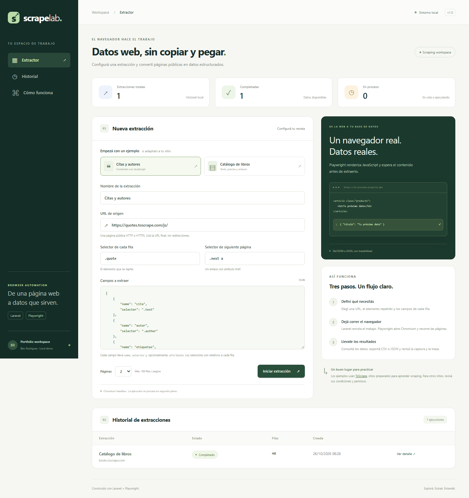
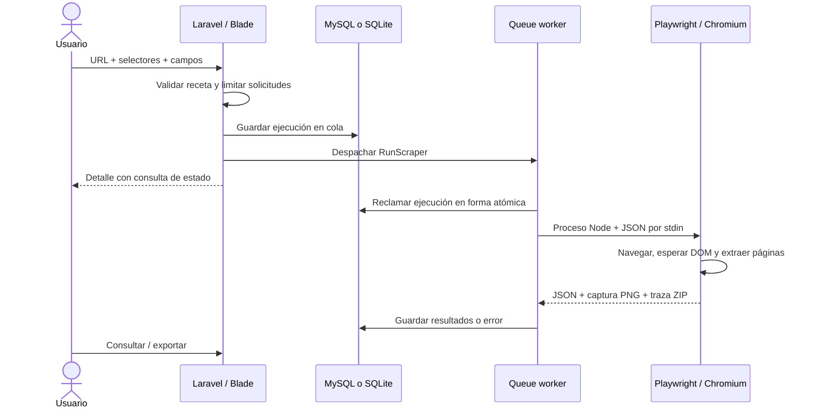
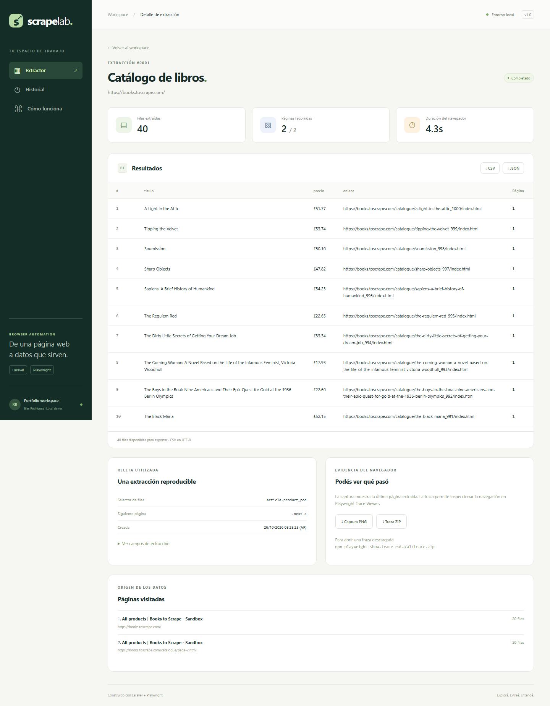

# ScrapeLab · Laravel + Playwright


Un workspace para convertir páginas públicas en datos estructurados. Laravel valida y encola una receta; Playwright abre Chromium, espera contenido renderizado con JavaScript, extrae campos y recorre la paginación. Los resultados quedan en MySQL o SQLite, con exportaciones y evidencia del navegador.

Proyecto de portfolio de **Blas Rodríguez**. El objetivo es mostrar integración real de Playwright con una aplicación, además de pruebas de navegador.



## Qué podés hacer

- Elegir ejemplos de citas con JavaScript o un catálogo de libros.
- Configurar otra URL pública con selectores CSS propios.
- Extraer texto o atributos (`href`, `title`, `src`, etc.) de hasta 10 campos.
- Seguir enlaces de paginación: hasta 5 páginas y 100 filas por página.
- Consultar estados, duración, errores, páginas visitadas e historial paginado.
- Descargar resultados JSON/CSV, captura PNG y traza de Playwright.
- Ejecutar pruebas PHP, pruebas del scraper con Chromium y pruebas E2E de la interfaz.

Los ejemplos apuntan a [ToScrape](https://toscrape.com/), un entorno preparado para practicar scraping. No hay resultados ficticios precargados: el historial se construye con tus ejecuciones.

## Arranque rápido

Requisitos: **PHP 8.5**, Composer 2, **Node.js 22+**, npm y extensiones PHP habituales de Laravel. Para la base de datos, `pdo_mysql` con MySQL o `pdo_sqlite` con SQLite. El lock de Composer se generó con PHP 8.5.

```powershell
git clone https://github.com/blas-rodriguez/laravel_Playwright.git
cd laravel_Playwright
Copy-Item .env.example .env
composer install
php artisan key:generate
npm ci
npm run browsers
php artisan scraper:database
npm run dev
```

Abrí **http://127.0.0.1:8000**. `npm run dev` inicia Laravel y el worker juntos. No hace falta compilar assets: la interfaz usa Blade, CSS y JavaScript sin dependencias de frontend ni CDN.

En Linux/macOS, reemplazá `Copy-Item .env.example .env` por `cp .env.example .env`. En Linux, si faltan dependencias del navegador: `npx playwright install --with-deps chromium`.

### MySQL con WampServer

La configuración compartida en `.env.example` usa SQLite para facilitar que otra persona clone la demo. Para usar Wamp, iniciá el servicio MySQL y configurá tu `.env` local:

```dotenv
DB_CONNECTION=mysql
DB_HOST=127.0.0.1
DB_PORT=3306
DB_DATABASE=scrapelab
DB_USERNAME=root
DB_PASSWORD=
```

Usá tus credenciales reales; `root` sin contraseña solo corresponde a algunas instalaciones locales de Wamp. Luego:

```powershell
php artisan config:clear
php artisan scraper:database
```

El comando crea la base configurada si no existe y aplica las migraciones, sin usar `migrate:fresh`. Si el usuario no tiene permiso para crear bases, creá `scrapelab` desde phpMyAdmin y ejecutá `php artisan migrate`. Las tablas MySQL usan **InnoDB**, independientemente del motor predeterminado de Wamp.

Para trabajar desde Apache, el virtual host debe apuntar a `public/`, con `mod_rewrite` habilitado. El worker sigue siendo un proceso separado:

```powershell
php artisan queue:work --tries=1 --timeout=210
```

Si Apache no encuentra Node, indicá la ruta completa en `.env` y reiniciá el worker:

```dotenv
SCRAPER_NODE_BINARY="C:/Program Files/nodejs/node.exe"
```

## Configurar otro sitio

1. Buscá el elemento que se repite en el inspector del navegador: por ejemplo, `article.product`.
2. Definí los campos con selectores relativos a ese elemento.
3. Si hay paginación, indicá el selector del enlace de siguiente página.
4. Ejecutá y revisá datos, captura y traza.

Ejemplo de campos:

```json
[
  { "name": "titulo", "selector": "h3 a", "attribute": "title" },
  { "name": "precio", "selector": ".price_color" },
  { "name": "enlace", "selector": "h3 a", "attribute": "href" }
]
```

Sin `attribute`, se toma `textContent`, se normalizan espacios y se limita cada valor a 5.000 caracteres. `href` y `src` se convierten a URLs absolutas. Un campo ausente devuelve `null`. `:scope` permite extraer el texto o un atributo del propio elemento de la fila. Los nombres de campos deben ser únicos, empezar con una letra y usar letras, números o guiones bajos.

Cada sitio necesita sus propios selectores: no existe un selector universal para cualquier página. Los ejemplos incluidos se pueden modificar en `config/scraper.php`.

## Arquitectura



Puntos de entrada:

| Archivo | Responsabilidad |
| --- | --- |
| `app/Http/Requests/StoreScrapeRunRequest.php` | Validación de la receta |
| `app/Jobs/RunScraper.php` | Estados, reclamo atómico y persistencia |
| `app/Services/PlaywrightScraper.php` | Contrato PHP → Node con Symfony Process |
| `scripts/scrape.mjs` | Automatización real con Playwright |
| `scripts/lib/network-policy.mjs` | Validación de destinos de red |
| `app/Http/Controllers/ScrapeRunController.php` | Historial, detalle y descargas |
| `tests/node/` | Scraping real contra fixture HTTP con contenido JS |
| `tests/e2e/` | Pruebas de interfaz con Playwright Test |

### Decisiones técnicas para explicar en una entrevista

- **Playwright Library y Playwright Test tienen funciones distintas.** La librería ejecuta el scraping; el runner prueba la aplicación.
- **Esperas por contenido.** Se usa `domcontentloaded` y un locator visible, sin depender de `networkidle`. La pausa de 700 ms entre páginas controla la frecuencia de navegación, no la carga del DOM.
- **Evaluación en el navegador.** `locator.evaluateAll()` extrae los campos en un solo recorrido. Los selectores se pasan como datos, sin evaluar código proporcionado por el usuario.
- **Proceso aislado.** PHP ejecuta Node con una lista de argumentos y envía la receta por stdin, sin concatenar entradas en comandos de shell.
- **Cola persistente.** Una actualización condicional reclama cada ejecución. Una entrega duplicada del job no repite una ejecución que ya salió de `queued`. No se reintenta automáticamente un sitio que falló.
- **Timeouts coordinados.** Navegación: 25 s; locator: 12 s; proceso Node: 190 s; job: 210 s; `retry_after`: 240 s. En Windows, el timeout de Symfony Process limita el subproceso sin depender de `pcntl`.
- **Evidencia.** Captura del viewport de la última página y traza con snapshots. La traza también intenta guardarse cuando falla una navegación.
- **Datos acotados.** Los resultados se guardan como JSON en `scrape_runs`, junto con la receta. Esto simplifica campos variables para una demo de hasta 500 filas; una versión de alto volumen necesitaría tablas de resultados, streaming y retención de artefactos.
- **Salida segura.** Blade escapa el texto extraído. El CSV incluye BOM UTF-8 y neutraliza valores que podrían ejecutarse como fórmulas; el JSON conserva el valor original.



## Pruebas

```powershell
php artisan test --compact
npm test
npm run test:e2e
```

- **PHP:** validación, protección de campos internos, cola, idempotencia, estados, errores, escape HTML y exportaciones.
- **Node + Chromium:** fixture con JavaScript diferido, paginación, enlaces relativos, campos ausentes, HTTP 404, captura, traza y restricciones de red.
- **Playwright Test:** presets, validación y viewport móvil. Usa una base SQLite separada en `storage/framework/testing/e2e.sqlite`, con su propio servidor y worker; no modifica la base de la demo.

La prueba E2E contra el sitio público es optativa para no hacer depender CI de un tercero:

```powershell
$env:SCRAPELAB_LIVE_TESTS="1"
npm run test:e2e
Remove-Item Env:SCRAPELAB_LIVE_TESTS
```

En Linux/macOS: `SCRAPELAB_LIVE_TESTS=1 npm run test:e2e`.

GitHub Actions instala PHP, Node y Chromium y ejecuta las tres suites. Las trazas de pruebas fallidas se suben como artefactos. El workflow queda disponible al subir el repositorio; su estado depende de la ejecución en GitHub.

Para abrir una traza descargada:

```powershell
npx playwright show-trace ruta/al/trace.zip
```

## Alcance y límites

Esta versión es una **demo local sin autenticación**. No debe exponerse directamente como servicio público. Antes de alojarla, agregá autenticación y autorización por usuario, límites globales de concurrencia, retención de artefactos y aislamiento de la red de salida del navegador.

El motor admite páginas públicas HTTP(S), contenido JS en el DOM principal y paginación con enlaces `href` dentro del mismo origen. Usá la **URL final**: las respuestas con redirección HTTP se bloquean, también en recursos secundarios. El interceptor obtiene cada respuesta con `route.fetch({ maxRedirects: 0 })` y solo la entrega al navegador si no redirige; así evita que Chromium siga un salto fuera de la validación. No implementa login, CAPTCHA, evasión de bloqueos, scroll infinito, navegación por botones sin enlace ni extracción dentro de iframes. No interpreta `robots.txt` automáticamente: usá sitios propios, de práctica o con permiso, y respetá las condiciones del destino.

Se rechazan redes privadas/reservadas, credenciales en URLs y puertos distintos de 80/443. Se vuelven a validar los destinos de las solicitudes del navegador y se bloquean WebSockets y service workers. La validación DNS de la aplicación **no reemplaza un firewall de salida** frente a DNS rebinding u otros accesos internos del navegador. La única excepción de loopback vive en la API de pruebas Node, en un puerto fijo; la receta web no puede activarla.

Las capturas y trazas pueden contener datos de la página visitada. Se guardan en `storage/app/private/scrapes/{id}/`, excluidas de Git. No subas `.env`, credenciales, bases de datos o artefactos de navegación al repositorio público.

## Recorrido de demo en una entrevista

1. Ejecutá **Citas y autores** y explicá por qué Playwright espera contenido generado por JavaScript.
2. Ejecutá **Catálogo de libros** con dos páginas: mostrás atributos, URLs absolutas y paginación.
3. Descargá JSON/CSV y abrí una traza para mostrar qué hizo Chromium.
4. Usá un selector inexistente y explicá el timeout, el estado fallido y cómo diagnosticarlo.
5. Mostrá las pruebas locales y el workflow de CI. Separá los tests deterministas de la prueba optativa contra un sitio real.

Documentación de referencia: [Laravel Queues](https://laravel.com/docs/13.x/queues), [Playwright Library](https://playwright.dev/docs/library), [Locators](https://playwright.dev/docs/locators), [Trace Viewer](https://playwright.dev/docs/trace-viewer).

## Licencia

MIT. Ver `LICENSE`.
